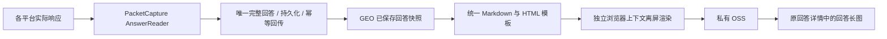

# 回答长图：验证结果与开发交接

> 本文保留早期离线原型记录。2026-10-22 用户已确认的平台近似样式、手机宽度、操作栏、追加建议、搜索摘要、正文图片要求及实际上传进度，以 [移动端回答长图接入参考](mobile-answer-longshot.md) 为准；下文旧版统一模板和首版媒体范围不再代表最终要求。

更新：2026-10-22。结论：**完整回答数据 → 统一 HTML → 浏览器离屏渲染 PNG** 已完成本机离线可行性验证，适合作为安卓六平台的公共出图方案。正式任务接入、持久化重试、生产字体与浏览器环境仍待开发。

本文可以直接交给后续 agent。先完成“实施顺序”，按“验收条件”交付；本轮没有实现生产功能，也没有改变六平台支持状态。

## 1. 目标与职责

手机继续通过现有 `AnswerReader` 采集、关联和确认完整回答，按现有协议回传。GEO 在回答提交成功后，读取已保存的回答快照生成长图，写入私有 OSS。手机无需截图、滚动或读取整个页面元素树，也无需新增图片上传协议。



产品文案使用“回答长图”或“回答渲染图”，图片标注“根据已采集回答重新排版”。这不是豆包等 App 的原始屏幕截图，也不是与原界面逐像素一致的证据。新增平台只需提供相同完整回答结构，出图层不增加对应 App 的坐标、按钮或滚动规则。

## 2. 已实际验证的范围

测试使用本机 headless Edge，通过 Playwright 创建独立上下文。复用 GEO 当前 `frontend-vue/src/lib/render-markdown.ts` 的 Markdown 处理，额外限制回答 HTML 的样式和资源。固定画布宽 960 CSS px、deviceScaleFactor=1，加载本机中文字体后对完整容器截图，没有执行页面或手机滚动命令。

六份既有 `complete` 回答均来自保存的本机样本，没有发新问题、重跑采集或访问平台网站。含候选选择信息的样本必须为 `unique_complete`；只有单条结果的历史快照单独检查 `status=complete`。样本完成状态不等于本轮重新验证了对应平台实时链路。

| 样例 | PNG 尺寸 | 引用条数 | 结果 |
| --- | --- | --- | --- |
| 豆包既有回答 | 960 × 2651 | 12 | 出图通过 |
| 元宝既有回答 | 960 × 611 | 0 | 出图通过；仅显示层去除已知内部标注 |
| DeepSeek 既有回答 | 960 × 599 | 0 | 出图通过 |
| 文心既有回答 | 960 × 1632 | 16 | 出图通过 |
| 千问既有回答 | 960 × 1103 | 7 | 出图通过；未知原始占位保持可见 |
| Kimi 既有回答 | 960 × 922 | 0 | 出图通过；推理与正文分区 |
| 合成复杂排版 | 960 × 1754 | 2 | 中文、标题、表格、嵌套列表、代码、超长链接通过 |
| 合成 60 段长文 | 960 × 9194 | 0 | 60 个唯一段落标记顺序完整、末尾标记存在 |
| 合成不可信 HTML | 960 × 712 | 0 | 脚本未执行、无图片/iframe 残留、无网络请求 |
| 合成超长文 | 测量高度 85015 | 0 | 截图前按尺寸限制拒绝，未截成半张成功图 |

另外四项入口检查正确拒绝 `incomplete`、`failed`、空 `complete`、`ambiguous`。共 14 项场景检查：9 项生成 PNG，5 项按预期拒绝；这不是生产测试套件数量。

9 张 PNG 全部核对实际文件尺寸、页尾存在、无元素横向溢出、字体加载完成、引用条数与输入一致。输入问题/回答/推理/引用在渲染前后 hash 一致。浏览器记录的 HTTP(S) 请求均为零，原始正文未修改。逐张联系表已目视检查，未发现正文遮挡或裁切。60 段长文另核对唯一标记数量与末尾；并未对所有真实回答做逐字 OCR 或逐像素原 App 比较。

最后一次运行，9 张正常图在浏览器已经启动的条件下，每份约 0.4–0.8 秒；最大正常图约 784 KiB。此数字包含单份上下文/排版/截图时间，不包含浏览器冷启动、排队、生产环境或 OSS 上传，不能作吞吐承诺。

## 3. 开发前阅读与当前入口

PacketCapture 先读根 `AGENTS.md`、[架构](architecture.md)、[回答接口](automation-v1.md)、[手机调度](android-scheduler.md)。GEO 的根 `AGENTS.md` 和当前开发规则必须另行读取；两仓库有既有未提交改动，按实际分支与 diff 保留。

| 位置 | 已有行为 / 后续用途 |
| --- | --- |
| PacketCapture `app/.../scheduler/AndroidScheduler.kt` | 唯一完整回答先落盘 outbox，再上传；本方案通常无需修改 |
| PacketCapture `llm/.../AnswerReader` 与各 Decoder | 保留原始语义及完成门槛，出图不改变解码器 |
| GEO `backend/app/services/android_rpa.py::result` | 校验任务平台和冻结问题；幂等 result hash；保存原回答与 resultJson，commit 后返回 accepted |
| GEO `backend/app/schemas/android_rpa.py::ResultInput` | 已有 answer/reasoning/searchSources/decoder/packageName/sessionId/exchangeId/appVersion 等输入；不需要加入图片/Base64 |
| GEO `frontend-vue/src/lib/render-markdown.ts` | 已有 marked + DOMPurify、展示标记规范化；复用规则时核对保真与引用映射边界 |
| GEO `backend/app/services/brand_monitor_screenshots.py` | 现有私有 OSS 上传、10 MiB 限制和短期读取 URL；异常不改变答案状态 |
| GEO `backend/app/models/brand_monitor.py` / Prisma | 原回答有 final screenshot object key；按现有模型确定增加何种来源及状态元数据 |
| GEO `frontend-vue/src/components/BrandMonitorTaskScreenshot.vue` | 现有图片展示入口；增加渲染图类型的准确文案，沿用权限检查 |
| GEO `rpa/camofox-browser/app/answer_screenshot.py` | 网页 DOM 克隆长图，仅参考预算/字体稳定等原则；本方案不依赖平台网页 DOM |

GEO 已安装的 Python 依赖声明包含 Playwright，前端有 marked、DOMPurify。本轮为了快速验证用 Node 调用本机 Playwright，并将现有 TS 函数转译后注入页面；这不是生产部署方式。正式实现可由 Python Playwright 调用预打包的可信 HTML/JS 资源，不为该功能无条件增加 Node 常驻进程。浏览器二进制和中文字体是否存在，必须在部署目标单独检查。

## 4. 输入、图片内容和保真规则

出图输入应从服务器已确认的回答快照构建，而不是再向手机拉取；服务器自行提供 tenantId/taskId/androidJobId。内部建议结构如下，具体命名按 GEO 现有领域模型统一，不新增公共设备接口：

```json
{
  "schemaVersion": 1,
  "kind": "answer_render",
  "templateVersion": "answer-render/1",
  "provider": "doubao",
  "prompt": "合成问题",
  "answer": "## 合成回答\n\n正文。",
  "reasoning": "",
  "searchSources": [{"title": "合成来源", "url": "https://example.com/a", "index": 1}],
  "referenceCaptureStatus": "collected",
  "decoder": "doubao-chat-sse/2"
}
```

- 统一展示：平台名称、问题、正文、参考来源，以及必要的生成/采集时间。时间来自已保存记录并明确时区；不能把渲染时间冒充回答时间。
- 推理默认不纳入回答长图，与 GEO 网页专用长图现有边界保持一致。需要展示时使用显式选项并单独分区，将选项纳入幂等 hash。本轮 Kimi 已验证分区可行，不意味着正式版默认公开推理。
- 原始 `answer/reasoning/searchSources` 持久化值保持不变。已知 `[](@mark_underline=N)` 等仅在展示副本清理，并记录规范化版本；未知占位原样转义显示，或给出明确说明，不能为整洁无声删除。
- 结构化引用按原顺序保存和展示 URL/title/index。数组展示序号不自动等于平台原始 index；没有经解码器验证的映射时，不把 `[citation:N]` 等占位强行关联到第 N 条来源。本轮传空映射以避免现有前端的启发式引用关联，结构化来源另列。
- 正文外部图片、视频、商品卡首版不下载。Markdown 图片显示“图片未纳入本次渲染”；采集不到的富媒体明确标注范围。现有 renderer 会移除某些媒体占位，正式接入需要补显示说明，不能直接照搬到完整视觉承诺。
- 首版支持文本/GFM：标题、强调、段落、列表、引用块、表格、代码和链接。公式、Mermaid、交互卡片、任意原始 HTML 不属于本轮通过范围；无专用渲染器时保留转义文本并说明，不直接吞掉。

## 5. 实施顺序与完成标准

### 第一步：独立纯渲染器

在 GEO 新增与平台无关的回答渲染模块：输入可信任务身份和已保存回答快照，输出 PNG bytes、尺寸、hash、templateVersion 与 warnings。HTML 模板、CSS、Markdown JS 及字体由部署工件固定提供。

完成标准：合成夹具通过第 8 节排版、保真、安全和预算检查；渲染代码没有平台网页导航、手机控制或业务计费操作。

### 第二步：接入已提交回答，持久化图片工作状态

`android_rpa.result` 继续按现有规则接受并提交完整回答。生成工作在回答成功提交之后执行，不把 PNG 生成/OSS 上传放到持有设备行锁或回答事务的路径中，也不延迟手机 accepted 响应等待截图。

利用 GEO 已有可靠任务设施；如没有合适设施，再增加最小的持久化待渲染记录与扫描执行器。单纯 FastAPI BackgroundTasks/内存队列不能承担交付保证。若记录与回答不能同事务落盘，提供扫描补偿“符合条件但缺少渲染记录的已完成安卓回答”，覆盖进程恰好在 commit 后退出的窗口。

完成标准：模拟进程在 commit 前后退出、客户端重复回传、渲染异常，答案仅保存一次，图片工作最终可发现且不重复发题；安卓任务与租约无需等待图片即可正常结束。

### 第三步：私有存储与原详情展示

复用已有私有 OSS 字节上传和授权读取。现有上传函数的 `rpa_task_id` 来自浏览器任务，本方案没有 RpaChatTask：应将身份提取为适合安卓 job 的 artifact 标识，或增加明确的安卓对象键函数，不能伪造浏览器任务。

写回图片 key 前重新校验 taskId、tenant、androidJobId、answer hash 和模板版本仍一致。保留既有网页图片；避免同一字段静默覆盖不同来源图片。新增元数据至少能区分 `answer_render` 与 `page_capture`。字段/表/迁移以实际 GEO 模型为准。

完成标准：原回答详情能查看完整长图，长图按宽度展示并可纵向滚动；权限、租户隔离和短期 URL 沿用原逻辑，数据库不保存公开裸 URL；文案准确区分渲染图和原屏截图。

## 6. 幂等、恢复与错误

建议渲染状态为 `pending → rendering → ready/failed`，主动跳过记 `skipped`；状态独立于安卓 job/回答业务状态。对外枚举按 GEO 约定使用英文值与中文说明。

幂等键包含 `tenantId + taskId + androidJobId + renderInputHash + templateVersion + renderOptions`。hash 输入使用稳定序列化，覆盖 question/answer/reasoning/sources 与实际展示选项。不要直接复用安卓 result_hash 作为图片幂等键，因为模板和展示选项会变化。

保存尝试次数、渲染租用/开始时间、结束时间、错误分类、图片尺寸/字节数/SHA256。执行器崩溃后可恢复超时的 rendering；并发去重并限制工作进程资源。写入 OSS 成功后数据库写回失败时，按确定对象键重试写回，不重新采集答案。

暂时性浏览器/存储错误有限重试同一快照。尺寸超限、输入不完整和格式不支持属于明确终态，不反复重试；保留答案并允许后续人工重生成渲染图。错误不得将原回答改为 FAILED、退款、重开租约或重新发送问题。历史回答批量补图属于另行授权的运维范围，不在首次上线时自动全量执行。

## 7. 渲染与资源约束

建议首版固定 960 CSS px 宽、deviceScaleFactor=1、单列白底。截图前等待本地字体完成和布局稳定；表格/代码/超长 URL 要换行，不依赖水平滚动，不以缩小整张图方式掩盖裁切。

借鉴现有网页长图预算：宽≤4096、高≤24000、总像素≤4000万、PNG≤10 MiB，均包含留白。截图前测量尺寸，编码后再检查实际字节数。超限明确返回错误，首版不裁掉尾部；分张导出属于后续需求。原输入允许很长，不等于可以无上限出图；还需设置输入大小、DOM 节点和模板复杂度预算，避免先展开无限内容再测尺寸。

建议单份总处理预算 30 秒、初始并发 1，按生产资源测试调整；这是实施建议，未做压力验证。设置浏览器退出、上下文关闭和任务取消的清理路径。

模型返回的文本/HTML/URL均作为不可信输入：先 Markdown 解析再净化，只允许明确的排版标签与属性；清除脚本、事件属性、原始 style、表单、iframe、object 等。模板本身才可以运行固定脚本。启用限制性 CSP，浏览器上下文阻断外部网络，禁止读取任意本地路径和导航到回答中的 URL；日志只写身份/hash/错误码，不打印回答或带查询凭据的 URL。

本机原型为加载本地字体使用了 `--allow-file-access-from-files`；生产不要复制该宽松启动方式。由固定模板内联、打包或受控请求拦截提供字体/资源，同时拒绝模型控制的 file://、HTTP、WebSocket 等资源。数据化 URI 是否开放按明确资源类型白名单决定。生产 Linux 字体需固定版本并确认授权；Windows 微软雅黑不能直接当可分发资源复制。

## 8. 正式验收条件

| 类别 | 必须验证 |
| --- | --- |
| 完整性 | 非 complete、空正文、歧义不作为成功完整长图；原始回答与来源数据不变 |
| 通用性 | 六个平台使用相同模板和出图函数；已知展示规范化单独管理版本 |
| 排版 | 中文、emoji、中英混排、标题、列表、GFM表格、长代码/URL；无横向裁切；首尾完整 |
| 引用/推理 | 来源顺序和原 index 保留，无虚构关联；推理按显式选项分区 |
| 预算 | 输入、节点、尺寸、总像素、字节、超时分别生效；超限不截成半张成功图 |
| 安全 | XSS、CSS注入、外部资源、localhost/私网/云元数据/本地文件 URL 不可触达 |
| 幂等/故障 | 重复回传不重复出图；浏览器崩溃、OSS失败、写回失败和重启可恢复；不改答案状态 |
| 权限/展示 | 原详情与图片授权一致；跨租户不可读；长图按宽度滚动查看；准确来源文案 |
| 部署 | 目标系统的浏览器/中文字体真实出图；冷启动、资源占用、并发和清理实际验收 |

单元测试只用合成数据。本机真实快照可按已有私有材料约定离线回放；不将真实回答、账号、session、token 或链接查询参数写入公共测试夹具/文档。

## 9. 本轮证据与重现（本机忽略目录）

相对 PacketCapture 根目录：

- `artifacts/wsa-longshot-20261022/test_answer_render.cjs`：10份渲染样例 + 4个入口拒绝检查，读取既有真实样本，复用 GEO 现有 Markdown 函数；只写忽略目录。
- `artifacts/wsa-longshot-20261022/inspect_answer_render.py`：核验9份 PNG 尺寸并生成联系表/合成预览。
- `artifacts/wsa-longshot-20261022/answer-render/report.json`：最后运行结果、浏览器版本、渲染函数 hash、输入 hash、耗时和字节数。
- `artifacts/wsa-longshot-20261022/answer-render/`：9张 PNG、私有 HTML、`contact-sheet.png`；`synthetic-rich-preview.png` 可用于展示样例。

本机执行：

```powershell
& 'C:\Users\dexte\.cache\codex-runtimes\codex-primary-runtime\dependencies\node\bin\node.exe' artifacts/wsa-longshot-20261022/test_answer_render.cjs
& 'C:\Users\dexte\.cache\codex-runtimes\codex-primary-runtime\dependencies\python\python.exe' -X utf8 artifacts/wsa-longshot-20261022/inspect_answer_render.py
```

该脚本依赖本机 GEO node_modules、Edge 和既有私有快照；换机器应编写合成夹具的正式测试，不能假设 artifacts 随 Git 交付。模板 HTML 本身不包含渲染 JS，因此单独双击保存的页面不等于重新运行测试。

本轮没有操作手机/WSA、创建任务、发题、读写数据库、上传 OSS、启动 GEO 服务、安装依赖或修改 GEO 运行源码。仅完成离线原型和本交接文档。前一轮 WSA 原生滚动拼接是另一个实验，不是本轮方案的依赖。
