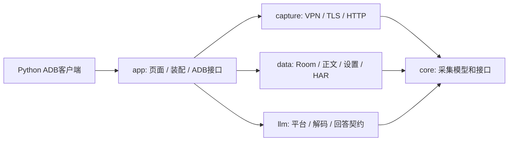

# 多平台抓包与手机任务工具

Packet Capture 是未来手机端工具 App 的代码主体。GEO 负责品牌监测任务、租户、调度及分析；手机工具负责设备操作、采集与证据输出。当前完成采集和结果读取接口，尚未实现手机主动领取任务、自动提问或上传 GEO。

实际排查过程和可复用验证方法见 [抓包开发经验](capture-development-notes.md)。

## 依赖与职责

`core` 定义采集模型、生命周期和持久化接口。`capture` 只处理网络，不识别品牌、GEO 任务或模型平台。TLS 域名映射保留为用户配置，禁止把平台实验 IP、证书或账号写进代理。`data` 保存原始证据，负责正文解压、截断和恢复。

`llm` 是独立 JVM 模块。`AnswerReader.read(sessionId, selector)` 集中完成应用归属、筛选、解析和完整性判断。它依赖 `CaptureRepository`、`BodyStore`，读取解压后的正文，输出版本化 DTO，不接触 Android、数据库表或网络流。`app` 装配具体实现，UI 文档导出和 ADB 使用相同规则。`clients/python` 只读取结果，不包含设备操作和品牌分析。

## 平台扩展

稳定 ID 与 GEO 的 provider ID 对齐。平台目录不代表已经支持解密或回答解析。

| ID | 平台 | 当前状态 |
| --- | --- | --- |
| `yuanbao` | 元宝 | `verified_sample`：2.88.0 原生 `/api/chat/` HTTP SSE 样本，目标应用需信任本机 CA |
| `doubao` | 豆包 | `discovery`：候选包已识别，解密与协议待验证 |
| `kimi` | Kimi | `discovery`：包名、解密与协议待目标手机验证 |
| `qianwen` | 千问 | `discovery`：包名、解密与协议待目标手机验证 |
| `wenxin` | 文心一言 | `discovery`：包名、解密与协议待目标手机验证 |

`PlatformCatalog` 的包名是候选值，需与手机安装包核对；未命中时仍可用通用应用选择器抓包。手动选择其他包名不会自动获得平台身份，渠道包需要更新目录并验证归属。网络转发成功、HTTP 200 或能看到打字动画均不能证明已经得到完整回答。

新增适配流程：

1. 核对包名和版本，在通用抓包中取得真实明文请求/响应，记录 TLS 和传输前提。
2. 在 `llm` 新增内部 `AnswerDecoder` 实现，限定方法、域名和路径。不要将历史查询当作实时回答。
3. 在 `AnswerReader` 注册。按实际协议处理增量、累积快照、替换、推理文本、来源和终止事件，不套用元宝 `msg` 追加逻辑。
4. 用脱敏或合成样本验证完整、错误、截断、重连、Unicode、协议变更和来源，再真机核对答案及终止状态。
5. 更新目录支持状态和已验证版本；禁止提交带登录态的 HAR 或私人对话。

目前只有元宝有实际解码器。未知平台 SSE 返回 `unsupported`，不输出伪造答案；未知归属不猜测。非 SSE 暂不进入回答结果，原始 HTTP/TCP/UDP 证据仍能手动导出。未知事件拒绝宣称完整，避免协议升级静默污染监测结果。`reasoning` 目前为空，后续按协议分开提取。来源 `collected` 仅表示取得 URL，不保证穷尽或逐句关联。

## 后续在本项目加入手机执行功能

下一阶段将任务执行能力放进本项目，由同一 APK 装配并复用采集模块。等任务契约和真实操作明确后再拆模块，当前不创建空壳。

| 职责 | 维护位置与约束 |
| --- | --- |
| 设备操作 | 按平台实现打开应用、输入、单次发送、等待、截图；与网络解码器分开，UI 改版不应牵动 TLS |
| 任务执行及本地日志 | 协调设备操作和 `CaptureController`；持久化 `taskId/attemptId`，绑定 `sessionId/exchangeId` |
| GEO 连接 | 负责认证、领取租约、心跳、上传结果与证据；只依赖任务/回答契约，不接触 Room 表和 CA 私钥 |

建议任务状态：`received → prepared → sent → collecting → completed/failed/needs_review`，另记取消和租约过期。先持久化任务与发送边界，再执行发送；崩溃后如果不能确认是否已发送，只采集已有记录或转人工，不直接重发。单手机串行执行任务，多手机由 GEO 调度。

关联记录至少包括任务/尝试 ID、provider、设备时间起点、原始问题、目标包及版本、采集会话与请求 ID、解码器版本、结果状态、证据摘要和错误分类。`taskId` 是调度身份，问题全文只是筛选条件；重复问题或自动重试产生多个候选时报告歧义，不擅自取最新一条。

GEO 上传建议映射为 `answer` 与 `metadata`：将 `searchSources` 放入监测元数据，附带 capture IDs、完整性、`referenceCaptureStatus` 和解码器版本。截图是独立证据。品牌命中、排名、情感与计费留在 GEO。

当前 ADB 接口仅用于开发联调。手机独立运行时，GEO 连接在本进程调用 `AnswerReader`，无需通过电脑或开放网络端口。VPN 授权、目标应用证书信任及设备操作权限仍按 Android 流程完成。

## 版本与数据维护

- DTO `schemaVersion=1`，增字段保持兼容；删除字段或变更含义须升级版本和客户端。
- 解码规则变化升级 `decoder`，如 `yuanbao-chat-sse/2`，以便核查历史结果。结果按原始证据即时计算，不重复持久化正文。
- 状态区分 `complete/incomplete/failed/unsupported`。原始存储受现有配额限制，截断必须阻止完成状态。
- 任务系统应先持久化结果并确认上传，再按保留策略清理证据。清空原始数据后无法重算。
- Git 只收源码、合成测试和公共说明；忽略本机技能、抓包、设备交接、APK、签名库及缓存。提交前仍须核查已经暂存的文件。
