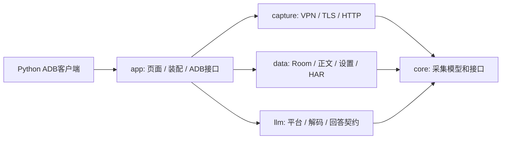

# 多平台抓包与手机任务工具

Packet Capture 是手机端工具 App 的代码主体。GEO 负责品牌监测任务、租户、调度及分析；手机工具负责领取任务、采集与证据输出。当前实现设备绑定、手机轮询、租约心跳、完整回答关联和幂等回传；豆包、元宝快速文本、DeepSeek 普通文本、千问快速模式有指定条件下的无障碍单次发题通过记录。文心、Kimi 已适配，完整链路仍待验收；2026-10-23 六平台批次只有豆包和元宝文本完成。长期后台执行与自动跨平台轮转仍待实现。实际协议、持久化和真机验证范围见 [手机调度接入](android-scheduler.md)。

实际排查过程和可复用验证方法见 [抓包开发经验](capture-development-notes.md)。

## 依赖与职责

`core` 定义采集模型、生命周期和持久化接口。`capture` 只处理网络，不识别品牌、GEO 任务或模型平台。TLS 域名映射保留为用户配置，禁止把平台实验 IP、证书或账号写进代理。`data` 保存原始证据，负责正文解压、截断和恢复。

`llm` 是独立 JVM 模块。`AnswerReader.read(sessionId, selector)` 集中完成应用归属、筛选、解析和完整性判断。它依赖 `CaptureRepository`、`BodyStore`，读取解压后的正文，输出版本化 DTO，不接触 Android、数据库表或网络流。`app` 装配具体实现，UI 文档导出和 ADB 使用相同规则。`clients/python` 只读取结果，不包含设备操作和品牌分析。

## 平台扩展

稳定 ID 与 GEO 的 provider ID 对齐。平台目录不代表已经支持解密或回答解析。

| ID | 平台 | 当前状态 |
| --- | --- | --- |
| `yuanbao` | 元宝 | `verified_sample`：2.88.0 原生 `/api/chat/` HTTP SSE 样本，目标应用需信任本机 CA |
| `deepseek` | DeepSeek | `verified_sample`：2.6.2 本地 CA 测试版 `/api/v0/chat/completion` 默认文本 SSE；未触发搜索、未启用深度思考，见 [实测记录](../DEEPSEEK-CAPTURE-TEST.md) |
| `doubao` | 豆包 | `verified_sample`：15.0.0 本地测试版 `/chat/completion` SSE；需原生 CA 信任、关闭额外正文加密及 UDP443 阻止以测试 TCP 回退 |
| `kimi` | Kimi | `verified_sample`：`com.moonshot.kimichat` 3.1.4 本地 CA 测试版，新对话 Connect JSON 文本及独立推理；见 [实测记录](../KIMI-CAPTURE-TEST.md) |
| `qianwen` | 千问 | `verified_sample`：7.4.7.3058 本地测试版、`com.aliyun.tongyi`、快速文本模式 `/api/v1/chat` SSE；需本地 CA 信任与定向 ECH 实验条件，见 [实测记录](../QIANWEN-CAPTURE-TEST.md) |
| `wenxin` | 文心一言 | `verified_sample`：`com.baidu.newapp` 5.20.0.11 本地 CA 测试版、普通文本 `/chat/completions` SSE；依赖私有目标域名 3 秒下游交付缓冲取得真实 HTTP 结束，见 [实测记录](../WENXIN-CAPTURE-TEST.md) |

`PlatformCatalog` 的包名是候选值，需与手机安装包核对；未命中时仍可用通用应用选择器抓包。手动选择其他包名不会自动获得平台身份，渠道包需要更新目录并验证归属。网络转发成功、HTTP 200 或能看到打字动画均不能证明已经得到完整回答。

新增适配流程：

1. 核对包名和版本，在通用抓包中取得真实明文请求/响应，记录 TLS 和传输前提。
2. 在 `llm` 新增内部 `AnswerDecoder` 实现，限定方法、域名和路径。不要将历史查询当作实时回答。
3. 在 `AnswerReader` 注册。按实际协议处理增量、累积快照、替换、推理文本、来源和终止事件，不套用元宝 `msg` 追加逻辑。
4. 用脱敏或合成样本验证完整、错误、截断、重连、Unicode、协议变更和来源，再真机核对答案及终止状态。
5. 更新目录支持状态和已验证版本；禁止提交带登录态的 HAR 或私人对话。

目前有元宝、豆包、千问、DeepSeek、文心和 Kimi 六个平台解码器。文心依赖本地 CA 与私有传输缓冲，普通构建不含该缓冲，旧取消样本仍保持失败。Kimi 读取 Connect 二进制帧，其他平台读取 SSE；只接收已验证协议，未知归属不猜测，未知事件拒绝宣称完整。Kimi 的 `reasoning` 与正文分开提取，其他已验证模式的推理为空。来源 `collected` 仅表示取得 URL，不保证穷尽或逐句关联。

`KimiDecoder`（`kimi-chat-connect/1`）限定 `POST https://www.kimi.com/apiv2/kimi.gateway.chat.v1.ChatService/Chat` 和 `application/connect+enum_num+json`。请求与响应均有 1 字节标志加 4 字节大端长度，必须读取解压后原始字节，不能把 UTF-8 预览重新编码。`data` 只保留该 MIME 的原始字节，`llm` 验证协议并分开追加 text/think。新对话要求当前问题回显、聊天/父子消息/块身份、连续非心跳 eventOffset、推理阶段结束、助手完成、done、Connect 结束帧及完整 HTTP/正文同时成立。工具、搜索、附件、续聊及未知模式保持 unsupported。v1 的 `source=android_capture_sse` 保留为兼容标识，实际格式由 decoder 指明。

`YuanbaoDecoder`（`yuanbao-chat-sse/2`）保留 `text.msg` 原始增量。仅接受形状匹配的 `mark` 标注快照：正整数标注 ID、已出现的结束标记、已知起止字段，去除已观察的 replace/mark_underline 占位后须与已累积正文完全一致；快照不追加、不替换答案。未知结构或正文变化仍为 unsupported，传输和终止检查不变。

`DoubaoDecoder`（`doubao-chat-sse/2`）只匹配 `POST https://api5-normal-gl.doubao.com/chat/completion`。问题取当前 `messages` 的文本块，不取 `option.history_messages`；多条当前消息返回 `unsupported`。答案按 `STREAM_MSG_NOTIFY` 初始文本、`STREAM_CHUNK` 文本追加和 `CHUNK_DELTA` 顺序重建，用户回显、心跳、扩展字段不计入答案。完成要求文本块结束、匹配的消息身份、顺序为 1/2/3 的 `SSE_REPLY_END`，并通过正文与传输完整性检查。已验证搜索 scene=2/search_type=1 的加载块结束、同 ID 移除与 content_status=100 转换；来源仅取明确 `search_query_result_block.results` 的 text_card/video_card，有效 HTTP(S) URL 按首次出现去重并保留显式 index。推荐 rich_media_block 视频仍不当搜索来源；其他模式、域名、正文替换及推理协议待验证。

`QianwenDecoder`（`qianwen-chat-sse/1`）仅匹配 `POST https://chat2.qianwen.com/api/v1/chat`，限快速文本 `v2`/增量策略 1/JSON patch。问题取当前单条 `messages[].content`；只将 `multi_load/iframe` 初始内容与 `add /content` 按顺序追加。`signal/post`、过程栏、交互控件元数据及遥测不进入答案；原始占位保留。来源来自 workflow 的 `bar_ref_source_inline` 文档，按有效 HTTP(S) URL 去重，后续空快照不会清空已有来源；不推断引用索引。完成需匹配请求/会话身份、从 0 连续的 `resid`、无错误/断连信号、文本及出现过的 workflow 结束、`complete`/`sse_end="1"`，并通过通用正文与传输检查。其他模式、域名、快照替换及推理协议待真实样本验证。

`DeepseekDecoder`（`deepseek-chat-sse/1`）限定 `POST https://chat.deepseek.com/api/v0/chat/completion` 与 `com.deepseek.chat` 归属。问题取当前 `prompt`；默认文本模式保留初始 RESPONSE fragment 和沿用 p/o 的 APPEND 增量，BATCH 元数据、会话、标题及 TTS 控制事件不计入答案。完成需 ready/初始响应的消息身份匹配、FINISHED、close 且 auto_resume=false，以及完整正文与传输。实际搜索、深度思考、附件、多 fragment、替换及恢复流返回 unsupported；来源为空、推理为空，其他版本待真实样本验证。

TLS 明文和可读实体是两个条件；豆包曾在 HTTPS 内继续加密正文。成功明文样本的响应仍带 `x-tt-e-b: 1`，解码器结合正文是否可解析判断，不能仅凭头字段宣布加密或成功。版本与证据见 [豆包实测](../DOUBAO-STREAM-TEST.md)。

`WenxinDecoder`（`wenxin-chat-sse/1`）限定 `POST https://yiyanapp.baidu.com/chat/completions`，普通文本 `orion` 模式。问题取当前请求 `content`，新会话采用服务端初始身份，续聊核对请求身份；后续严格核对消息、父消息及连续 `chunkIndex`。答案仅追加 `generator.data.component=markdown-yiyan` 的 `data.value`，排除无推理的 `thinkingSteps` 和输入建议，来源从 `reference.searchInfo` 按有效 HTTP(S) URL 去重并保留显式索引。要求 `errno=0`、`errmsg=success`、末尾 `finish=1` 及通用完整性检查。替换、深度推理、附件、未知组件与协议返回 unsupported；真实 C/D 样本均为 `FAILED/truncated`，其中 D 轮确认客户端 CANCEL，即使提取成功也保持 `failed` 和传输诊断，不报告 `unique_complete`。

2026-10-20 复测发现，客户端在语义完成后先取消，上游约 1.9 秒后才发 HTTP 分块结束。私有实验仅对目标域名的 SSE 下游交付增加 3 秒延迟，队列限 1 MiB / 1024 个对象，不解释 SSE 内容、不生成终止标记、不改变 `ExchangeBridge` 或完整性门槛。三份新样本实际收到上游 HTTP 结束并输出 complete，其中两份完成 GEO 入库；增加显示延迟，不能保证所有网络时序适用，也不代表官方原版已可解密。

## 手机调度与后续应用操作

同一 APK 通过 `app/.../scheduler/` 装配 GEO 连接、加密任务日志和回答采集，直接调用 `AnswerReader`。`app/.../execution/` 按包名和实际控件识别新对话、覆盖输入及核对原文，单次点击发送。四平台闭环及文心预检的模式和私有前提见 [执行器交接](android-executor-handoff.md)，已有采集证据不等于 APK 发题验收。

| 职责 | 维护位置与约束 |
| --- | --- |
| `PhoneExecutor` / `MonitorAccessibilityService` | 六平台界面适配与网络解码器分开；豆包、元宝、DeepSeek、千问有指定模式通过记录，文心与 Kimi 完整链路仍待验收；Kimi 最新发送修复未真机复验 |
| `AndroidScheduler` / `SchedulerJournal` | 领取后自动准备、检查完整回答及幂等回传；异常终态人工核对归档；加密保存任务、sessionId、时间边界与待回传结果 |
| `GeoClient` | 已实现 HTTPS 绑定验证、领取、心跳与结果上传；只依赖任务/回答契约，不接触 Room 表和 CA 私钥 |

服务端任务状态为 `queued → leased → completed/failed/expired`；手机另持久化 prepared、采集边界、执行阶段与待上传结果。轮询开启后自动准备；本地每 2.5 秒检查 `AnswerReader`，仅 `unique_complete` 持久化并上传；网络心跳与失败重试继续使用设置间隔。暂停停止自动检查，重新开启复用已保存边界及 outbox。单手机串行执行任务，已领取任务不自动重新入队。豆包在点击发送前先持久化 send_started；崩溃后无法确认时只采集已有记录，不补发。旧任务无执行阶段时保持人工模式；自动执行4分钟未完成按原协议提交失败。

关联记录至少包括任务/尝试 ID、provider、设备时间起点、原始问题、目标包及版本、采集会话与请求 ID、解码器版本、结果状态、证据摘要和错误分类。`taskId` 是调度身份，问题全文只是筛选条件；重复问题或自动重试产生多个候选时报告歧义，不擅自取最新一条。

GEO 上传已映射 `answer/reasoning/searchSources/referenceCaptureStatus/decoder/packageName/sessionId/exchangeId`，原任务的 resultJson 标记 `source=android_capture_sse`、`executionChannel=android`。仅 unique_complete 可进入成功回传，服务端确认后才清除待上传结果。截图上传仍待实现；品牌命中、排名、情感与计费留在 GEO。字段与失败处理见 [手机调度接入](android-scheduler.md)。

当前 ADB 接口仅用于开发联调。手机执行时，GEO连接在本进程调用 `AnswerReader`，无需Python读取或额外开放采集端口；GEO本身仍需手机可访问的HTTPS地址，本机USB localhost桥仍依赖电脑。VPN 授权、目标应用证书信任及设备操作权限仍按 Android 流程完成。

## 版本与数据维护

- DTO `schemaVersion=1`，增字段保持兼容；删除字段或变更含义须升级版本和客户端。
- 解码规则变化升级 `decoder`，如 `yuanbao-chat-sse/2`，以便核查历史结果。结果按原始证据即时计算，不重复持久化正文。
- 状态区分 `complete/incomplete/failed/unsupported`。原始存储受现有配额限制，截断必须阻止完成状态。
- 任务系统应先持久化结果并确认上传，再按保留策略清理证据。清空原始数据后无法重算。
- Git 只收源码、合成测试和公共说明；忽略本机技能、抓包、设备交接、APK、签名库及缓存。提交前仍须核查已经暂存的文件。
